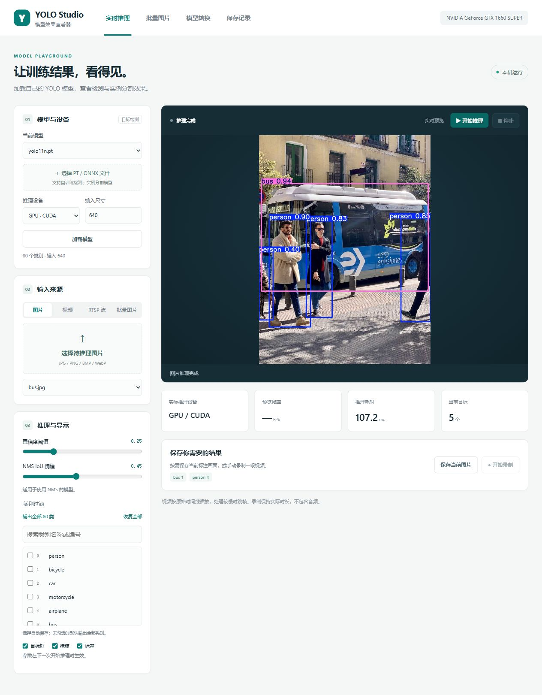
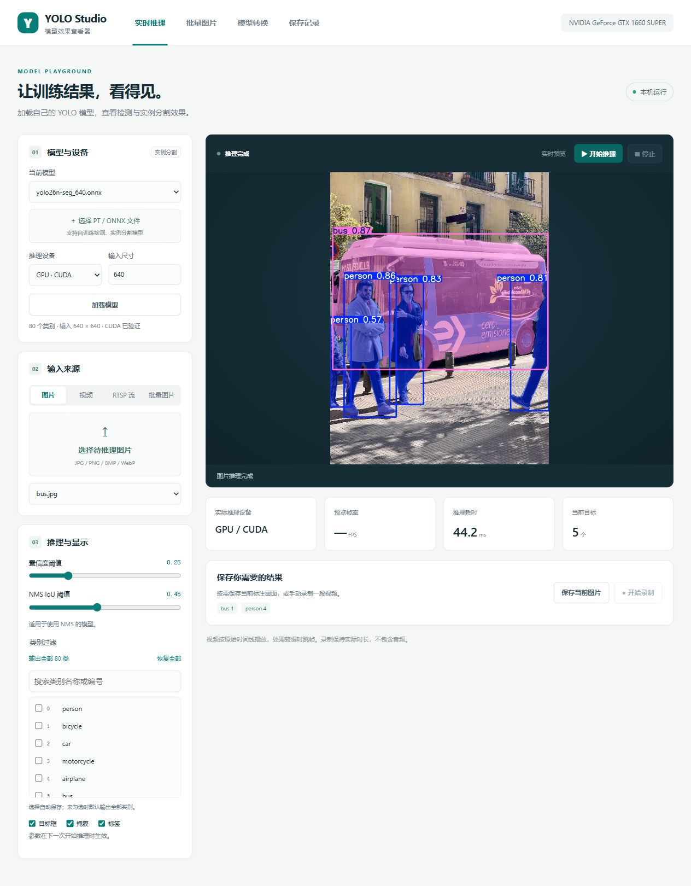
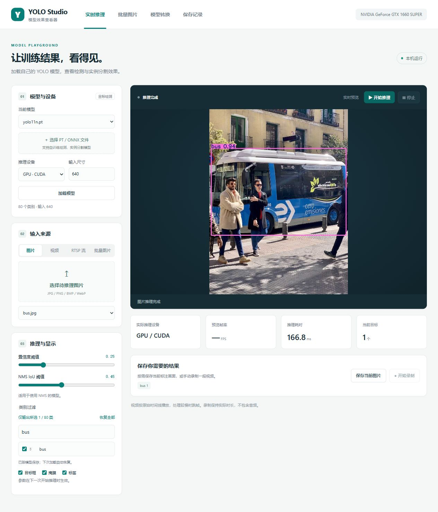
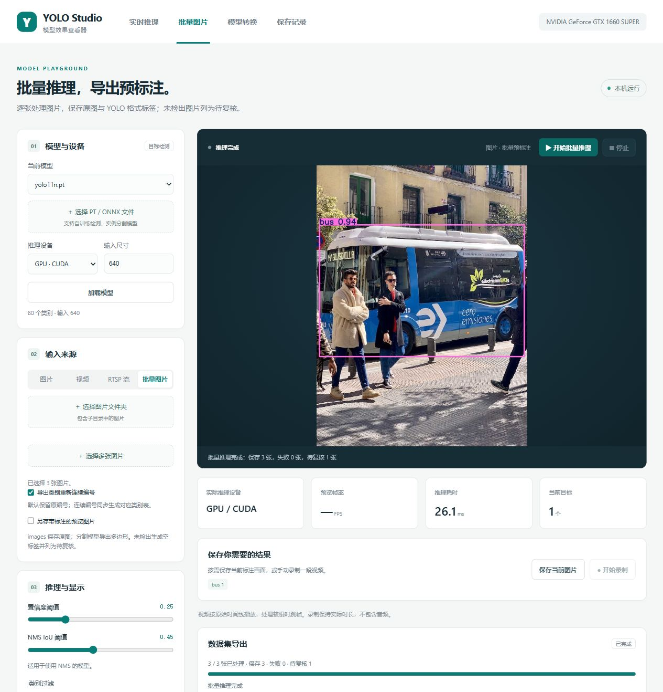
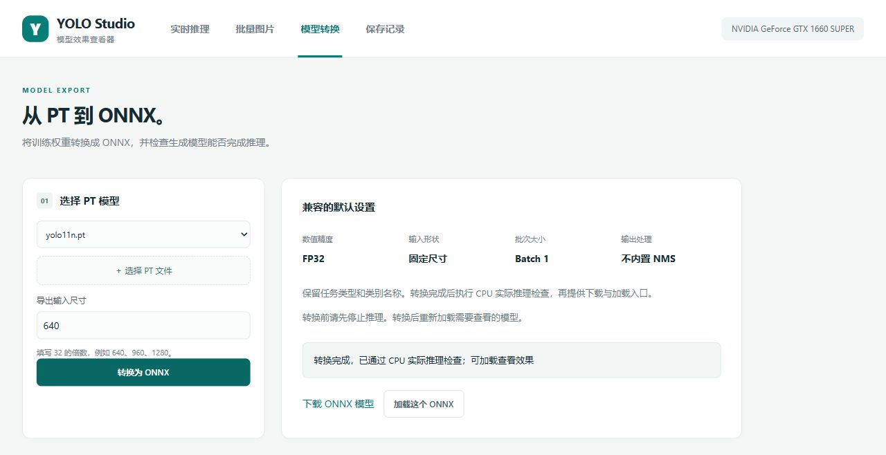

# YOLO 模型效果查看器

用于查看自己训练的 YOLOv8、YOLO11、YOLO26 目标检测／实例分割模型效果。支持 PT、ONNX，图片、视频、RTSP，CPU／NVIDIA GPU，批量图片导出 YOLO 预标注数据集，以及网页 PT 转 ONNX。

## 主要功能

| 功能 | 说明 |
|---|---|
| 模型与设备 | 加载 Ultralytics 标准 PT／ONNX 检测、实例分割模型，选择 CPU 或 NVIDIA GPU |
| 实时预览 | 图片单次推理，视频按原时间线播放，RTSP 处理最新帧并自动重连 |
| 类别过滤 | 勾选需要输出的类别，支持搜索和按模型保存；不配置时输出全部类别 |
| 结果保存 | 手动保存带标注图片，或录制带标注 H.264 视频 |
| 批量预标注 | 选择文件夹或多张图片，导出原图与 YOLO 标签；未检出生成空标签并列为待复核 |
| 模型转换 | PT 转 ONNX，保留任务／类别元数据，转换后执行实际推理检查 |

## 实际运行截图

以下是本项目当前版本的实际运行页面。演示使用官方 YOLO11n／YOLO26n 模型、[Ultralytics bus.jpg](https://ultralytics.com/images/bus.jpg) 和生成的空白图片。点击图片可查看原图。

<table>
  <tr>
    <td width="50%" valign="top">
      <b>目标检测</b><br>
      YOLO11n PT 在 GPU 上推理，显示目标框、类别、置信度与统计。
      <a href="docs/screenshots/detection.jpg"></a>
    </td>
    <td width="50%" valign="top">
      <b>实例分割</b><br>
      YOLO26n-seg ONNX 在 GPU 上推理，叠加目标掩膜，界面显示 CUDA 已验证。
      <a href="docs/screenshots/segmentation.jpg"></a>
    </td>
  </tr>
  <tr>
    <td width="50%" valign="top">
      <b>类别过滤</b><br>
      从模型的 80 个类别中只勾选 bus，画面和统计仅输出这一类别。
      <a href="docs/screenshots/class-filter.jpg"></a>
    </td>
    <td width="50%" valign="top">
      <b>批量图片与 YOLO 数据集</b><br>
      文件夹内 3 张图片全部处理完成，其中 1 张未检出生成空标签并列为待复核。截图取景避开完整本机输出路径。
      <a href="docs/screenshots/batch.jpg"></a>
    </td>
  </tr>
</table>

**PT 转 ONNX：** YOLO11n 权重转换完成，并通过 CPU 实际推理检查，提供下载和加载入口。



## 安装与启动

当前启动和安装脚本适用于 **Windows x64**，使用 Python 3.11。GPU 推理需要可用的 NVIDIA 驱动；没有可用 GPU 时可选择 CPU。Linux／macOS 尚未验证。

1. 下载仓库的 ZIP 并解压，或使用 Git 克隆仓库。
2. 确保电脑已有可用的 Python，安装 `uv`：

```powershell
python -m pip install --user uv
```

3. 重新打开终端，让系统识别 `uv`，然后双击 **安装依赖.cmd**。脚本通过 uv 配置 Python 3.11 和独立 `.venv`，安装锁定的依赖并下载 FFmpeg，不会替换其他项目的依赖。
4. 双击 **启动模型查看器.cmd**，浏览器打开 <http://127.0.0.1:8790>。

安装需要联网，下载的 PyTorch 依赖较大；不需要另行安装系统 CUDA Toolkit。GPU 能否使用以程序实际检查为准。已完成安装的电脑可直接运行启动脚本。

关闭浏览器不会关闭后端服务。结束使用时，运行 **停止模型查看器.cmd**，该脚本只停止本项目记录的进程。

## 查看自己的模型

1. 在“实时推理”页面点击 **选择 PT / ONNX 文件**，选择自己的 `best.pt`、`last.pt` 或标准 Ultralytics ONNX。
2. 选择 **CPU** 或 **GPU**，设置输入尺寸，点击 **加载模型**。加载时会检查任务、类别和实际推理设备。
3. 选择 **图片**、**视频** 或 **RTSP 流**。文件会复制到项目的 `data` 中；原文件不被修改。
4. 设置置信度、类别过滤，以及目标框／掩膜／标签开关，然后点击预览区右上角 **开始推理**。
5. 切换模型、设备、输入尺寸、输入源或参数时先停止，再加载或重新开始。当前版本的显示和阈值参数在下一次开始时生效。

### 类别过滤

加载模型后，在“推理与显示 → 类别过滤”中直接勾选需要输出的类别：

- 不勾选任何类别时，默认全部输出；点击“恢复全部”清除限制。
- 勾选部分类别时，仅返回这些类别的框／掩膜；目标统计及保存的标注图片、视频也遵循同一过滤。
- 可按类别名称或原始编号搜索。搜索只影响列表显示，不会取消隐藏类别的选择。
- 状态显示“输出全部 N 类”或“仅输出所选 K / N 类”，原始类别编号不变。
- 选择自动保存在项目 `data/class_preferences.json` 中，刷新页面或重启服务后，再加载同一模型即可恢复。
- 根据模型文件内容的 SHA256 区分配置：同名但内容不同的模型分别保存，重复上传同一权重可恢复原选择。PT 与 ONNX 是不同文件，分别配置。
- 参数在下一次点击“开始推理”时生效。正在运行视频／RTSP 时先停止，再修改；配置修改不会重绘已完成的上一幅结果。

该功能过滤推理结果，模型仍保留完整的类别结构。保存失败会提示并提供“重试保存”，不会把未保存配置显示为已保存。

模型类别自动从权重读取，不需要另外提供 `data.yaml`。使用自己的数据训练、调整类别数量或训练参数，属于正常支持范围。增加自定义网络层或更改输出头结构的权重需要对应代码适配。

ONNX 必须含有 Ultralytics 的任务与类别元数据。固定输入尺寸的 ONNX 使用模型实际尺寸，界面会显示该尺寸；填写的输入尺寸仅作用于 PT 或动态输入 ONNX。只支持 batch=1。第一版不支持 Pose、分类、OBB、多模型同时推理或多路视频。

公开仓库不包含模型权重、用户图片／视频、导出数据、虚拟环境、FFmpeg 二进制和运行日志。首次启动后请上传自己的模型与素材。官方 nano 演示模型和 bus 图片可由验证脚本按需下载；用户自训练权重不会随源代码发布。

## 实时播放

- 图片：单次推理，显示标注结果。
- 视频：按视频原始时间线播放；推理较慢时跳过旧帧。第一版没有暂停、拖动进度条或逐帧离线导出。
- RTSP：采用 TCP 连接，持续解码并只保留最新帧。连接中断时清除旧结果，自动重连；正在录制的片段会结束并保存，可在重连后手动开始新的录制。

CPU／GPU 选择指模型推理设备。视频解码由 OpenCV 完成，实际 FPS 与模型大小、图像尺寸、输入源和机器负载有关。页面的推理耗时包含模型调用的预处理与后处理，不包含标注绘制和预览编码；它不等于摄像头到浏览器的完整延迟。

PT GPU 会检查模型参数所在设备。ONNX GPU 会禁用运行时的静默 CPU 重试，并检查实际推理 profiling 中执行了 CUDA 节点；少量形状计算节点仍可能在 CPU 上执行。GPU 初始化或实际执行失败时显示错误，请修复环境或手动选择 CPU。

## 保存图片和视频

- **保存当前图片**：保存当前标注画面并触发浏览器下载，适用于图片、视频和 RTSP。
- **开始录制 → 停止并保存**：保存手动选定时间段的标注视频，格式为 MP4 / H.264，不包含音频。
- 录制按实际经过时间，以 20 FPS 保存；推理较慢时重复上一幅标注画面，保持正常视频时长。20 FPS 是输出帧率，不代表每秒完成了 20 次推理。
- 本地视频结束或点击停止推理时，会自动结束并保存已开始的录制。自动保存的文件可在“保存记录”中下载。
- 保存文件同时保留在 `data/outputs`。默认不录制，不导出框、掩膜等推理结果 JSON。

录制期间会生成临时 AVI，停止后再编码成 MP4。请保留足够磁盘空间并等待保存完成，再停止服务。若编码失败，原始 AVI 会保留，页面会提示错误。

## 批量图片与 YOLO 数据集

1. 打开 **批量图片**，选择并加载 PT／ONNX，设置 CPU／GPU、输入尺寸、置信度、IoU 和类别过滤。
2. 点击 **选择图片文件夹**（包含子目录）或 **选择多张图片**。非图片文件自动忽略；格式为 JPG／JPEG／PNG／BMP／WebP。
3. 默认保持模型的原始类别编号；若想训练只包含所选类别的新模型，可勾选 **导出类别重新连续编号**。例如原编号 2、5 映射为 0、1，同时生成对应类别表。该选项不会修改模型和实时推理的类别配置。
4. 点击 **开始批量推理**。先上传，再逐张推理，不跳过图片；固定 batch=1 的 ONNX 也可使用。当前图片在预览区显示，数据集导出区显示进度、失败数、待复核数和目录。
5. 数据集保存在 `data/datasets/dataset_日期时间_任务编号`。可以直接使用本地目录，或点击 **生成 ZIP 下载** 后下载整个数据集；ZIP 按需生成，需额外磁盘空间。

```text
dataset_日期时间_任务编号/
├── images/             未叠加框／掩膜的图片
├── labels/             与图片同名的 YOLO .txt 标签
├── classes.txt         类别名称，行号就是导出类别编号（从 0 开始）
├── class_mapping.csv   原编号、导出编号、类别名称
├── report.csv          每张图片的来源、输出名称、状态、目标数、耗时和错误
├── review.csv          未检出或存在退化目标的待复核图片
├── 说明.txt
└── preview/            可选的带标注图片，默认不生成
```

- 检测模型：每行 `class x_center y_center width height`，坐标归一化至 0～1；不含置信度。
- 分割模型：每行 `class x1 y1 x2 y2 ...`，至少 3 个轮廓点；只导出分割多边形。显示开关不影响标签导出。
- **未检出：保存图片和空标签，并写入 review.csv。** 未检出也可能是漏检、阈值过滤或类别过滤，不能直接当作已确认负样本。
- 原图通常按字节复制，不修改源文件。带 EXIF 旋转／镜像方向的图片会转为方向规范化的 PNG，使标签与保存图像的坐标一致。可选预览另存到 `preview`，不混入训练图片。
- 输出名称添加任务内序号，避免同名图片、同名不同扩展名和不同子目录发生标签冲突；原始相对路径保存在 report.csv。
- 坏图等单张错误写入 report.csv 并继续。退化分割轮廓不写入无效标签，该图片列为待复核。
- **取消任务**：推理取消后保留已完成的图片／标签对，不把未处理图片导出为空标签。上传阶段取消后，再次开始可继续剩余上传；网页刷新后需重新选择图片。
- 任务记录保存在 `data/batches`，原始上传副本也位于这里。数据集、上传副本和 ZIP 分别占用磁盘空间，不会自动删除源图片或历史结果。
- 批量推理与实时推理、模型转换和数据集打包互斥。执行中不能切换模型或修改参数。服务中断的任务在重启后标为“服务中断”，不会标为完成；已保存结果需核对。
- 此版不划分训练／验证集，不生成带虚假训练／验证路径的 data.yaml。训练前先人工复核自动预标注，再配置数据划分和类别名称。

开发机验证：18 项自动检查；YOLO11n 检测／分割 × PT／ONNX × CPU／GPU 共 8 个实际组合，导出的标签通过 Ultralytics 训练数据标签校验器，ZIP HTTP 下载和内容检查通过。浏览器验证了文件夹上传、多图选择、子目录、非图片忽略、类别连续编号及下载。这些检查证明导出格式与功能可用，不代表自动标签已经人工审核；验证范围见 [验证说明](docs/VALIDATION.md)。

## PT 转 ONNX

1. 打开 **模型转换**，选择已上传的 PT，或上传自己的 PT。
2. 设置输入尺寸，必须为 32 的倍数，默认 640。
3. 点击 **转换为 ONNX**。导出固定尺寸、FP32、batch=1、opset 17 的模型，保留类别与任务元数据。
4. 转换完成后点击 **下载 ONNX 模型**，或 **加载这个 ONNX**，使用自己的素材检查效果。

转换使用权重的临时副本，不修改原始 PT。导出不内置 NMS，并统一使用与本工具 PT 推理相同的输出方式：当前锁定的 Ultralytics 版本用 `nms=None` 导出原始预测，再由推理程序后处理，避免 YOLO26 切换到另一输出头导致效果对比变化。

程序会检查 ONNX 图并执行一次 CPU 实际推理。这个检查证明文件可以运行；效果与数值一致性仍应使用自己的代表性素材确认。测试样例上 PT／ONNX 的类别和数量一致，不代表所有图片的输出完全相同。

## 项目结构

```text
app.py                  网页 API、上传下载、预览 WebSocket
run.py                  本机服务入口（127.0.0.1:8790）
yoloview/inference.py    模型识别、设备验证、推理与绘制
yoloview/engine.py       会话控制、视频时间线、RTSP 最新帧与重连
yoloview/batch.py        批量任务、YOLO 标签、待复核清单、ZIP
yoloview/recording.py    按实际时长录制、H.264 编码
yoloview/storage.py      文件索引与项目内路径
static/                 中文网页，不依赖外部 CDN
scripts/                安装、启动、停止、实际验证脚本
tests/                  会话停止、类别校验、录制时长测试
data/models/            上传的模型及导出的 ONNX
data/media/             上传的图片／视频
data/outputs/           手动保存的标注图片／视频
data/batches/           批量任务记录与上传副本
data/datasets/          原图、YOLO 标签与数据集 ZIP
logs/                   运行日志
.runtime/               FFmpeg、项目内运行配置
verification/           验证脚本生成的本地结果（不随仓库上传）
```

`data/assets.json` 仅记录上传文件身份与相对路径，是程序内部索引，不含目标坐标或掩膜结果。迁移已有素材时连同 `data` 一起复制；Python 虚拟环境需在新电脑重新安装。

## 验证与边界

本次使用 GTX 1660 SUPER（6GB）、PyTorch 2.6.0+cu126、ONNX Runtime GPU 1.22.0、Ultralytics 8.4.175 验证：

- YOLOv8n、YOLO11n、YOLO26n 的检测和实例分割，各执行 PT／ONNX × CPU／GPU，共 24 次真实模型推理。
- 六个模型从 PT 实际导出 ONNX，图检查和推理通过；在 bus 测试图片上，类别和目标数量与 PT 一致。
- 一份开发机自训练检测模型经过网页上传、GPU 加载、真实图片推理、图片保存和 PT 转 ONNX 验证；该模型未随仓库提供。
- 视频预览、WebSocket 图像与序号、截图下载、H.264 录制时长经过实际检查。
- 本机 MediaMTX 提供的真实 H.264 RTSP 流经过断线清除旧画面、结束录制和重连检查。

这些结果是本机功能与兼容性验证。真实摄像头网络、码流兼容性、长时间运行及自训练模型现场准确率尚需用实际输入验收。

验证范围见 [docs/VALIDATION.md](docs/VALIDATION.md)。包含本机路径和素材信息的原始验收结果仅保留在开发机；重跑验证时脚本会在 `verification/` 下生成报告。

需要重跑时，先启动服务，再在项目目录执行：

```powershell
.venv\Scripts\python.exe -X utf8 -m pytest -q tests
.venv\Scripts\python.exe -X utf8 scripts\verify_models.py
.venv\Scripts\python.exe -X utf8 scripts\verify_streams.py
```

后两项会上传验证模型／素材并控制当前会话，请在没有其他推理任务时执行。模型验证脚本会下载官方 nano 权重与测试图片；RTSP 验证脚本下载 MediaMTX 并启动只监听本机的临时服务，结束后关闭它创建的子进程。

完成 `verify_models.py` 后，可使用其模型与 bus 素材验证批量导出：

```powershell
.venv\Scripts\python.exe -X utf8 scripts\verify_batch.py http://127.0.0.1:8790
```

`verify_custom.py` 和 `verify_batch_edges.py` 是开发过程的辅助检查，需要对应自训练素材或事先完成指定浏览器操作，不属于下载仓库后的直接启动步骤。

## 第三方组件

依赖与来源见 [THIRD_PARTY.md](THIRD_PARTY.md)。仓库不分发第三方模型、媒体或运行时二进制；安装和验证脚本会从注明的上游来源下载相应组件。各组件和模型的许可分别以其上游声明为准。

## 常见问题

**GPU 不可用或加载失败**：确认 NVIDIA 驱动正常，运行“安装依赖.cmd”修复本项目依赖。错误详情在 `logs/stderr.log` 或 `logs/server.log`，可先选择 CPU 检查模型。

**ONNX 输入尺寸与填写值不同**：固定尺寸 ONNX 以模型尺寸为准，需要改变尺寸时用 PT 重新导出。

**模型加载失败**：确认是标准 Ultralytics 检测／实例分割权重、文件完整，且任务受支持。缺失 ONNX 元数据时用原始 PT 经本工具转换。

**RTSP 一直重连**：检查 URL、密码、摄像头在线状态和本机到摄像头的网络。当前采用 TCP。真实摄像头地址不会记录到文件索引。

**推理速度慢**：降低输入尺寸或使用更小模型；确认已选择并成功加载 GPU。页面显示的是实际执行设备。

**端口被占用**：默认 8790。一键启动会识别本项目的已有服务；其他程序占用时明确报错。自行改端口时需同时修改 `run.py` 与启动／停止脚本。
